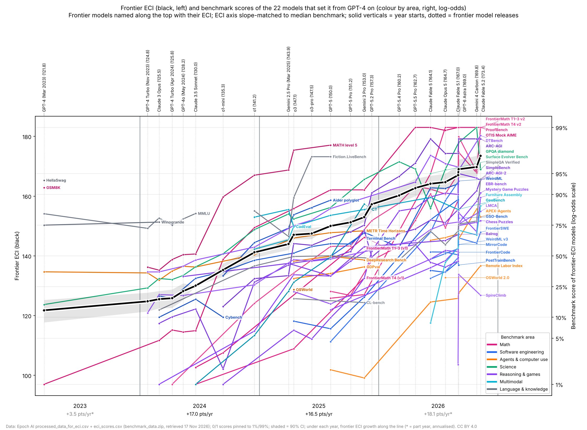
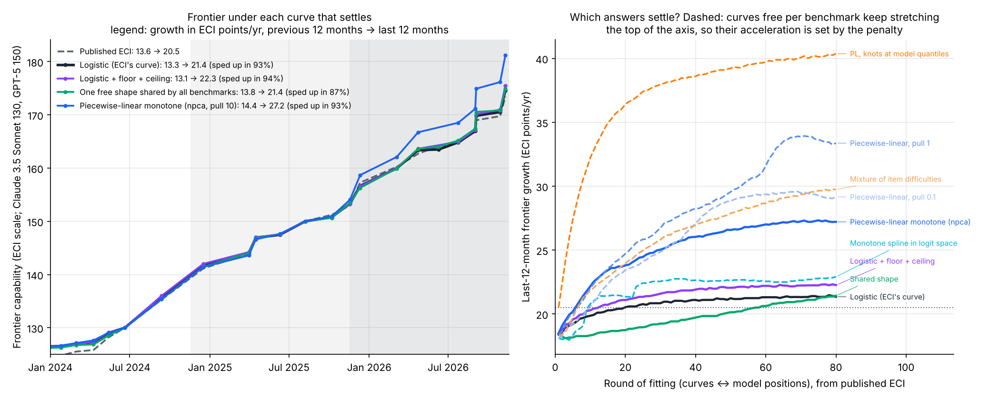
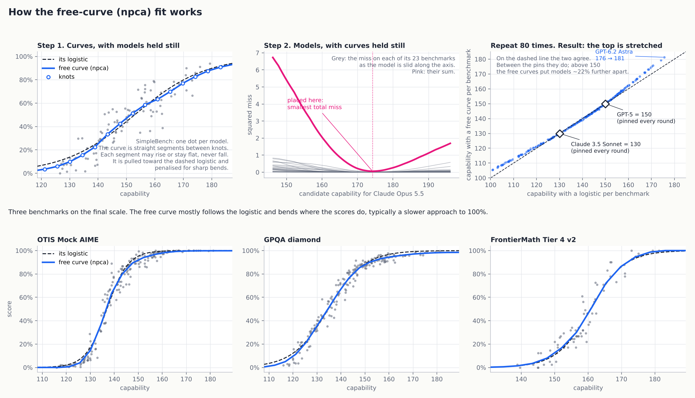
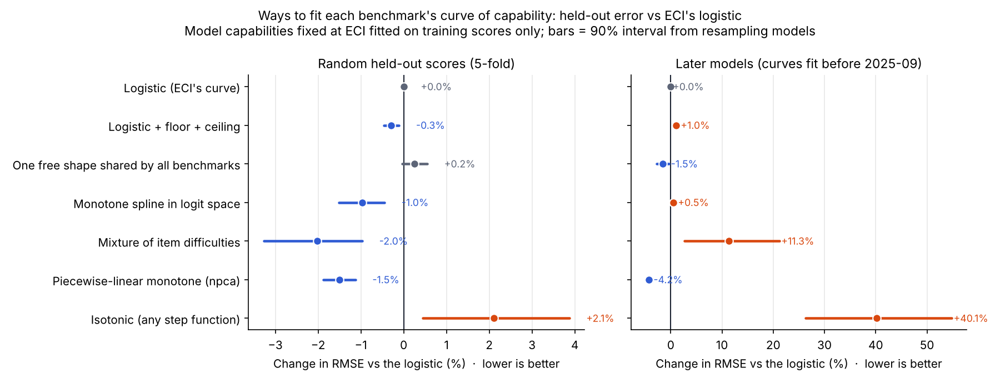
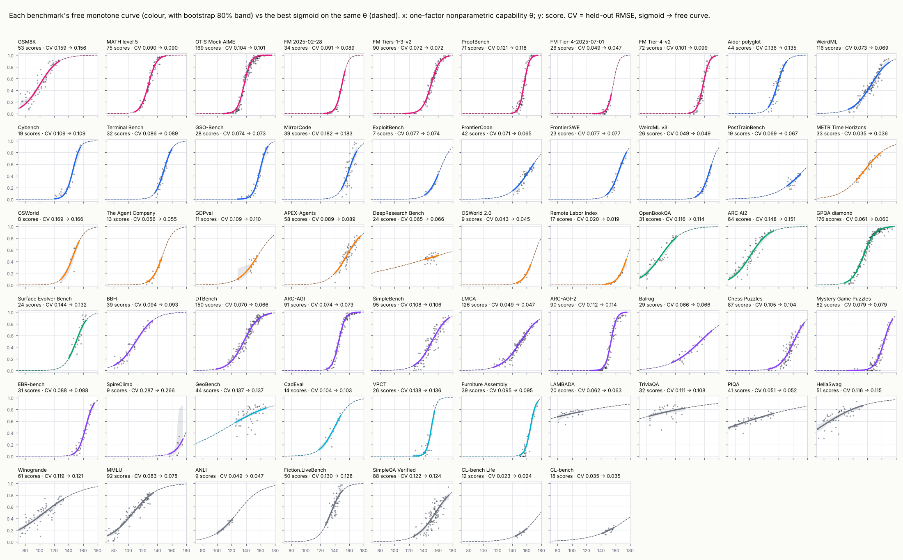

# ECI Explorer

**Dashboard: https://tecunningham.github.io/eci-benchmark-logodds/**

The dashboard ([`index.html`](index.html)) has four tabs:

1. **Frontier over time.** Frontier ECI with the benchmark scores behind it, in log-odds.
2. **Try other fitting choices.** Refit capability in your browser under a different link function, loss, clipping rule, penalty or model filter, and compare the frontier and its growth across fits. See [below](#trying-other-fitting-choices-in-the-browser).
3. **Fit by benchmark (residuals).** One panel per benchmark: does it follow a logistic in ECI?
4. **What frontier models still fail at.** For twelve benchmarks that are not yet saturated: ordered from least to most saturated (by the best score any model has), each with two failed tasks where a specific attempt by a current frontier model is documented (otherwise two sample tasks), as a table of task, reference answer (and how it was baselined), whether the task is solvable, and the agent's answer with its score; click a row for details. Each benchmark also has a line on whether 100% is attainable. Only evidence from the last six months is used. Sources: `data/failures_rows.json` (rows), `data/failures.json` (notes, built by `scripts/failures_curate.py` from `data/failures_full.json`).

> **Data update, 18 Nov 2026.** The data are Epoch's `benchmark_data.zip` as retrieved on 18 Nov 2026: 257 models (latest GPT-6.2 Astra, released 17 Nov 2026), 57 benchmarks, 2,895 scores. Since the 1 Oct snapshot Epoch has dropped five benchmarks from ECI (DeepSWE, HLE, Lech Mazur Writing, SWE-Bench verified, ScienceQA), added two (SpireClimb, WeirdML v3), and now drops models with fewer than four scores between 10% and 90%.
>
> **Epoch changed how ECI is fitted.** Its [code](https://github.com/epoch-research/eci-public) now defaults to a Bayesian fit: the same logistic curve, but as the mean of a Beta likelihood with a noise level per benchmark, sampled by MCMC. Least squares is kept only as a deprecated option. The published scores match the new fit: a quick best-fit version of it lands within 0.1 points of published ECI for the median model released since 2025, against 0.55 for least squares. So this repo's least-squares reimplementation (`scripts/eci_fit.py`) no longer reproduces published ECI exactly (median gap 0.9 points; several points for the weakest models and up to 1.4 for the strongest).

> **Working on this repo?** Start with [`NEXT_STEPS.md`](NEXT_STEPS.md): current findings, open questions and a map of the code.

## Key takeaways: is ECI measuring benchmark-score acceleration correctly?

Numbers are for the 18 Nov 2026 data unless marked. Growth is the rise of the frontier, in ECI points, over the last 12 months (to 18 Nov 2026) and the 12 months before.

1. **Epoch has changed the fit, and the change is small at the frontier.** Published ECI now comes from a Bayesian Beta-likelihood fit of the same logistic curve. Refitting by least squares, as Epoch did until October, moves the median model by 0.9 points and gives almost the same frontier growth: 13.3 → 22.0, against 13.6 → 21.1 published. On the 1 Oct data this repo's least-squares solver reproduced published ECI to within 0.06 points, so the arithmetic was never the issue; the analyses below still use least-squares refits.
2. **ECI's own speed-up depends on where the 12-month windows end.** Published frontier growth is 13.6 → 21.1 with windows ending 18 Nov 2026. Ending 1 Oct it is 14.7 → 19.9; 1 Sep, 15.9 → 16.6; 1 Aug, 17.1 → 15.5. The last year's rate rests on a few records since September (Claude Fable 5.2's 173.5 on 9 Nov is 4.3 points above the previous record, and GPT-6.2 Astra's 174.2 followed on 17 Nov), and a running maximum of noisy estimates is biased upward. A straight line through the daily frontier since October 2024 rises 16.9 points a year. So "ECI shows acceleration" is not established either way.
3. **The logistic curve systematically mispredicts newer models.** Fit curves on models released before Sep 2025, then predict half of each later model's scores from the other half ([`scripts/npca_forward.py`](scripts/npca_forward.py)). Later models score 18.5 points *above* the logistic's prediction where it predicts under 20%, and 7 points *below* where it predicts over 80%.
   - Benchmarks saturate more slowly than a logistic assumes, so the last points toward 100% need more capability than ECI credits.
   - The piecewise-linear curves predict later models 1–7% better than the logistic, with the best at a pull of 1 (−7.4%, 90% interval −9.3% to −5.1%). A floor and ceiling make no difference (+0.2%). One shared free shape is clearly worse (+23%), so the gain comes from benchmark-specific shapes.
4. **A free curve per benchmark makes recent growth look faster than ECI says; a common shape does not.** Extra last-year growth over the logistic, for window ends from July to November 2026:
   - logistic + floor + ceiling: +0.1 to +1.0 points a year
   - one shared free shape: −0.6 to 0.0
   - the piecewise-linear curve (pull 10): +3.6 to +5.3
   - weaker pulls: +6.7 to +13

   The ratio of last-year to previous-year growth is 1.88 for the piecewise-linear curve against 1.65 for the logistic and 1.55 for published ECI.
5. **But the size of the correction is not identified.** Above GPT-5 (fixed at 150), nothing pins the spacing between models except the curve's shape.
   - The curves the forward test favours (weak pulls) do not settle in joint fits: at a pull of 0.1, last-year growth goes 27, 29, 33 points a year at rounds 40, 60 and 80.
   - The same sensitivity shows up when only the link function is changed (the “Try other fitting choices” tab of the dashboard): a log-log link, which approaches 100% slowly, puts the top model at 193 instead of 174.
   - Random cross-validation is nearly blind to spacing, so the piecewise-linear curve's 27 points a year reflects a chosen pull, not an estimate. The honest summary: ECI probably understates how fast frontier capability rose in the last year, by an amount these data can't pin down, and whether growth is *accelerating* at all depends on the measurement window.

Epoch AI's [Capabilities Index](https://epoch.ai/eci) (ECI) fits one capability number per model from ~60 benchmarks, using

    score = sigmoid(slope_b × (ECI_model − difficulty_b))

so on a log-odds scale every benchmark should rise linearly with ECI. These charts plot that directly: the benchmark scores of the models that set the frontier ECI, in log-odds, with frontier ECI overlaid on a second axis.



- **Interactive version:** https://tecunningham.github.io/eci-benchmark-logodds/ (source [`index.html`](index.html)). Choose a lab to see that lab's own frontier (running best ECI among its models), with the overall frontier dashed for comparison. Untick benchmarks to **refit ECI** on the rest (see below). The chart runs full width, and the page has three more controls:
  - **Curve:** shows the frontier under any benchmark curve whose joint fit settles: Epoch's logistic, logistic plus floor and ceiling, a shared free shape, or the piecewise-linear curve. The method is in the nonparametric section below.
  - **Scale:** *Scores in log-odds* is the original view. *Capability each score implies* maps every score back through its benchmark's own fitted curve onto the frontier's axis. For the logistic, that is each benchmark's log-odds rescaled by its own slope and difficulty. Before mapping, each score is pinned to 1%–99% of the way from its curve's floor to its ceiling, as the log-odds view pins scores to 1%–99%. Pinned scores are drawn hollow. Without the pin, a score at or past a fitted floor or ceiling, which the curve can't invert, would land at the end of the range; this mattered most for logistic + floor + ceiling.
  - **From:** zooms in by moving the earliest date shown.
  - **Click a model's name** along the top to highlight only the benchmarks that model has a score on, with its own scores enlarged; click again to clear. The link records it (`#m=Claude%20Fable%205.2`).
  - **Hover** a score to see the capability it implies and its **weight in that model's capability**. Least squares places a model where its misses balance; linearised, that makes its capability a weighted average of the capabilities its scores imply. Each score's weight is its curve's slope at the model's capability, squared, and the hover shows its share of the model's total. Scores where the curve is flat, near 0% or 100%, barely count. Scores where the fitted curve has already saturated carry almost no weight. (On the 1 Oct data these weights rebuilt every model's capability from its implied values to within 0.12 points, median; not re-checked since.)

  - **Fit by benchmark (residuals) tab:** one panel per benchmark (all 57), plotting every model's score against its ECI with the fitted logistic, to check the logistic assumption. Toggles: scores + fitted curve or residuals (score − fitted); log-odds or linear y-axis; a shared ECI range (default) or each panel's own; colour by release date or area; highlight one lab; order panels by area, difficulty (hardest or easiest first), number of scores, RMSE, or how S-shaped the misfit is. A dotted line shows the fitted curve plus a kernel-smoothed local average of the residuals. Averaging residuals rather than raw scores avoids the edge bias a smoother of raw scores has. Hover a point for the model, score, prediction and residual.
    - **How far the local average should wander if the logistic were exactly true:** a parametric bootstrap ([`scripts/resid_null.py`](scripts/resid_null.py), 200 simulations, ~2 min; `--sims 1000` for finer p-values). It draws binomial scores from the least-squares fit's curves, with an effective number of items per benchmark (median 29) matched to each benchmark's real scatter, then refits with the least-squares objective. Each panel gets a simultaneous 90% band for the local average and a misfit p-value (RMS of the local average of log-odds residuals, against the simulations).
    - **Result:** 12 of 57 benchmarks have misfit p ≤ 0.05 (3 expected by chance), 8 at p ≤ 0.01. All benchmarks together give p = 0.015. The worst are WeirdML, FrontierCode, GPQA diamond, ARC-AGI, MMLU, ProofBench, Cybench and ARC-AGI-2.
    - **Caveats.** A low p rejects the whole model (one capability per model, a logistic per benchmark, independent noise), not only the curve shape. Area-specific strengths, scores correlated within a model or lab, and benchmark versions changing over time would all produce misfit. Calibrating the noise to the real scatter makes p conservative; correlated noise, which the simulation leaves out, would make it too small. The simulations are of the least-squares fit, while the panels now show Epoch's published Bayesian fit, so the band and p are approximate. Link: `#tab=resid` (plus `ry=linear`, `rshow=resid`, `rx=own`, `rsort=hard`).

  The two fixed points of the scale, Claude 3.5 Sonnet ≡ 130 and GPT-5 ≡ 150, are marked under every curve. The link records every setting, e.g. `#lab=OpenAI&curve=monotone&scale=implied&from=2025-01-01`.
- **Right axis:** each benchmark's score for the models that set a new frontier ECI, as log-odds, labelled in percent. Colour is the benchmark's area.
- **Left axis:** frontier ECI (running maximum by release date), drawn as straight lines between successive records, with its 90% interval. The axis is scaled so a benchmark with the median fitted slope (0.116 logits per ECI point) runs parallel to the ECI line.
- **Top:** the record-setting models from GPT-4 (Mar 2023) on, with their ECI.
- **Under each year:** how many ECI points the frontier line rose between 1 January and 31 December. Starred years are only partly covered (from the first record, or up to the latest one) and are annualised.

## Nonparametric version: is progress accelerating, and how does that depend on the curve?

**Interactive:** https://tecunningham.github.io/eci-benchmark-logodds/npca.html (source [`npca.html`](npca.html)).

### Is progress accelerating? It depends on the curve



[`scripts/npca_accel.py`](scripts/npca_accel.py) fits each curve option *jointly* with capability. It alternates between fitting the curves and placing the models, 80 rounds from published ECI, with Claude 3.5 Sonnet = 130 and GPT-5 = 150 fixing the scale. It then measures the frontier's growth in the last 12 months (2025-11-18 to 2026-11-18) against the 12 months before. Growth is in ECI points per year.

| Curve | Previous 12 months | Last 12 months | 90% interval, last 12 months | Share of resamples that sped up |
|---|---|---|---|---|
| Published ECI | 13.6 | 21.1 | | |
| Logistic (ECI's curve) | 13.3 | 22.0 | 16.9–29.2 | 94% |
| Logistic + floor + ceiling | 13.1 | 22.9 | 16.2–30.0 | 94% |
| One free shape shared by all benchmarks | 13.7 | 21.9 | 14.2–26.1 | 88% |
| Piecewise-linear monotone (npca, pull 10) | 14.4 | 27.2 | 18.3–36.2 | 97% |
| Monotone spline in logit space | 13.0 | 23.1 | does not settle | — |
| Piecewise-linear, pull 1 | 15.8 | 32.5 | does not settle | — |
| Piecewise-linear, pull 0.1 | 15.7 | 33.0 | does not settle | — |
| Piecewise-linear, knots at model quantiles (pull 10) | 14.7 | 41.0 | does not settle | — |
| Mixture of item difficulties | 16.0 | 29.7 | does not settle | — |

Intervals come from 100 refits on benchmarks resampled with replacement. They're only computed for curves whose answer settles.

- **The earlier rate is roughly agreed: 13.1–14.4 points a year under every curve that settles.** ECI's logistic says growth rose to 22 points a year, a speed-up in 94% of resamples.
- **Curves tied to a common shape agree with the logistic:** 22.9 with a floor and ceiling, 21.9 for the shared free shape.
- **The piecewise-linear npca curve gives 27.2**, about 1.9 times the earlier rate, with a speed-up in 97% of resamples. Its interval is wide (18.3–36.3). It is the curve that is clearly better on later models in the comparison below.
- **The direction is robust; the size isn't.** A curve that is free per benchmark doesn't pin down the spacing between models. With a weaker pull toward the logistic, quantile-placed knots, or an item mixture, the fit keeps stretching the top of the axis, and the last-year rate reaches 30–41 points a year (dashed lines in the figure). At a pull of 0.1 it is still rising after 80 rounds (27.1, 28.7, 33.0 at rounds 40, 60, 80). Only curves tied to a common shape give a number set by the data.
- **Mechanism.** Logistic curves fitted on older models rise too steeply. Later models score above the prediction where predicted scores are low, and below it near the top. In the 80–100% band, the error is −0.070 for the logistic and −0.056 for the piecewise-linear curve. So benchmarks saturate more slowly than the logistic assumes, and the last points toward 100% take more capability than ECI credits.

**Which benchmarks drive it?** [`scripts/curve_fits.py`](scripts/curve_fits.py) refits both curves with each benchmark left out in turn. The extra last-year growth of the piecewise-linear curve over the logistic (5.2 points a year) survives every single drop (3.5–6.9), so no one benchmark carries it.
- **Largest contributors:** ProofBench (+1.72), SimpleBench (+1.07), ARC-AGI-2 (+1.00), MirrorCode (+0.96), Furniture Assembly (+0.85).
- **Pulling the other way:** OTIS Mock AIME (−1.67), DTBench (−0.32), WeirdML (−0.25).
- The per-benchmark implied shifts are in `data/curve_leverage.json` and on the nonparametric page.

### How the free-curve (npca) fit works



ECI gives each benchmark an S-curve with two numbers, a midpoint and a steepness. The free-curve fit ("npca", for nonparametric PCA) lets each benchmark draw its own curve instead ([`scripts/npca_explainer_figure.py`](scripts/npca_explainer_figure.py) draws the figure).

- **The curve.** A chain of 27 straight segments joined at evenly spaced knots along the capability axis. Each segment may rise or stay flat but never fall, so a stronger model is never predicted to score lower. Two penalties keep it sensible: one against sharp bends, and one pulling it toward that benchmark's own best-fitting logistic. The pull matters most where a benchmark has few scores, and its strength ("pull 10") is the setting varied in the tables.
- **Step 1: curves, with models held still.** For each benchmark, fit that curve to its scores by least squares.
- **Step 2: models, with curves held still.** Slide each model along the axis to the point where its squared misses, summed over its benchmarks, are smallest.
- **Re-pin and repeat.** After each round, shift and rescale the axis so Claude 3.5 Sonnet is at 130 and GPT-5 at 150. Start from published ECI and run 80 rounds.
- **What comes out.** Between the two pins the free-curve scale agrees with the logistic one. Above 150 it puts models about 22% further apart, and the next section explains why.

### Why does the free curve read more growth? An intuition

[`scripts/npca_why.py`](scripts/npca_why.py) checks four things.

1. **It is a uniform stretch of the top of the scale, not a re-weighting of benchmarks.** Between the two anchors (130–150) the piecewise-linear scale tracks the logistic one for one (slope 1.01). Above 150 it is stretched by about 22% (slope 1.22). The gap between today's strongest models and those of a year ago goes from 17.7 points to 21.7.
2. **No particular benchmarks drive it.** Every benchmark's own scores imply a bigger gap under the free curve (typically 16–18 points becoming 20–21), and each benchmark carries almost the same weight under both curves. The near-saturated benchmarks carry almost none under either.
3. **The data only weakly ask for it.** If the top were really compressed, benchmarks would look *steeper* among models above 150 than among models at 125–150. On the 11 benchmarks with enough scores on both sides they are, if anything, slightly flatter (median ratio 0.92, flatter on 7 of 11). The logistic's in-sample residuals above 150 are within about one point of zero in every predicted-score band.
4. **Fit quality does not depend on it.** Take the logistic scale, multiply every distance above 150 by a factor, and refit the free curves: in-sample RMSE is 0.0768, 0.0764, 0.0764, 0.0764, 0.0765 for factors 0.8, 1.0, 1.2, 1.5 and 2.0.

So the intuition is this. A logistic gives each benchmark one steepness, set mostly by the many models between the anchors, and that steepness is the yardstick carried up past 150: a move from 60% to 80% counts for the same capability wherever it happens. A free curve has no such yardstick. Each benchmark can be as flat or steep as it likes above 150, so the fit can slide the top models further apart and flatten every curve's upper end to match, at no cost in error. Which way it slides is decided by the curve's penalties and by small features of the data: benchmarks are slightly flatter near the top than a logistic (point 3, and the forward test's 7-point shortfall where the logistic predicts over 80%), and a curve that approaches 100% slowly reads each late gain as more capability. That is why the stretch grows as the pull toward the logistic weakens, and why it does not settle. The free curve's extra growth is therefore a statement about what the data *permit*, not what they *show*.

### Forward test of the joint fits: which curve predicts models above the top anchor?

[`scripts/npca_forward.py`](scripts/npca_forward.py) is the one held-out test that touches the spacing above GPT-5:
1. Run the joint fit (curves and positions, 80 rounds) on models released before 2025-09-01 only (1362 scores), starting from ECI refit on those scores. Both anchors are in this set.
2. Place each of the 104 later models from a random half of its scores, with the curves frozen. The frozen piecewise-linear curves are refit on knots reaching 80 points above the top training model, so they can extrapolate rather than go flat.
3. Predict the other half (530 scores, on benchmarks with at least 5 training scores).

| Curve | RMSE | vs logistic (90% interval) | Later minus predicted, where predicted < 20% | where predicted > 80% | Last-12-month growth, full joint fit |
|---|---|---|---|---|---|
| Logistic (ECI's curve) | 0.1775 | +0.0% (+0.0 to +0.0) | +0.185 | -0.073 | 22.0 |
| Logistic + floor + ceiling | 0.1778 | +0.2% (-0.4 to +0.9) | +0.185 | -0.053 | 22.9 |
| One free shape shared by all benchmarks | 0.2190 | +23.4% (+13.6 to +32.8) | +0.256 | -0.046 | 21.9 |
| Piecewise-linear, pull 30 | 0.1755 | -1.1% (-1.9 to -0.3) | +0.185 | -0.063 |  |
| Piecewise-linear, pull 10 (default) | 0.1724 | -2.9% (-3.8 to -1.9) | +0.181 | -0.054 | 27.2 |
| Piecewise-linear, pull 3 | 0.1663 | -6.3% (-7.6 to -4.9) | +0.172 | -0.054 |  |
| Piecewise-linear, pull 1 | 0.1644 | -7.4% (-9.3 to -5.1) | +0.164 | -0.051 | 32.5 |
| Piecewise-linear, pull 0.1 | 0.1662 | -6.4% (-10.6 to -2.0) | +0.157 | -0.066 | 33.0 |

- **Weaker pulls predict later models better, up to a point:** the error falls from −1.1% at a pull of 30 to −7.4% at a pull of 1, then gives a little back at 0.1 (−6.4%). On the 1 Oct data the ordering was monotone down to 0.1, and two other random splits agreed; those extra splits have not been re-run on the new data.
- **The shared free shape extrapolates badly** (+23%), where on the 1 Oct data it was not distinguishable from the logistic.
- **The forward test favours weak pulls**, and those are the curves whose joint fits do not settle. It therefore says the logistic's spacing above 150 is too compressed, without pinning the right spacing.
- **Not a measure of growth:** frontier growth computed from the forward-placed later models comes out at 52–62 points a year, because placing a model from half its scores, past the training range, is too noisy. It is stored in the json but shouldn't be read as a growth estimate.

Rebuild: `python npca_forward.py` (about 6 minutes on 3 cores) → `data/npca_forward.json`.

Rebuild (about 20 minutes on 8 cores; `curve_fits.py` another 6):

```bash
cd scripts
python npca_accel.py          # joint fits, iteration paths, bootstrap -> data/npca_accel.json
python npca_accel_figure.py   # -> figures/npca_accel.png
python curve_fits.py          # dashboard curves + leave-one-out -> data/curve_fits.json, data/curve_leverage.json
python npca_build_page.py     # -> ../npca.html
python build_page.py          # -> ../index.html
```

### Seven ways to fit a benchmark's curve

ECI assumes every benchmark's score follows a logistic curve of capability. [`scripts/npca_links.py`](scripts/npca_links.py) fits seven different curves to each benchmark and compares them on scores they never saw. Each model's capability is held fixed at ECI refit on the training scores only, so only the curve differs.



| Curve | Parameters per benchmark | Keeps spacing between models? | Random held-out RMSE (vs logistic) | Later-models RMSE (vs logistic) |
|---|---|---|---|---|
| Logistic (ECI's curve) | 2 | yes | 0.0979 (+0.0%) | 0.1711 (+0.0%) |
| Logistic + floor + ceiling | 4 | yes | 0.0976 (−0.3%) | 0.1729 (+1.0%) |
| One free shape shared by all benchmarks | 2 (+ 1 shared curve) | yes | 0.0981 (+0.2%) | 0.1684 (−1.5%) |
| Monotone spline in logit space | 8, penalised | only through the penalty | 0.0969 (−1.0%) | 0.1720 (+0.5%) |
| Mixture of item difficulties | 30 weights, penalised | no (keeps stretching in joint fits) | 0.0959 (−2.0%) | 0.1905 (+11.3%) |
| Piecewise-linear monotone (npca) | 28, penalised | only through the pull to the logistic | 0.0964 (−1.5%) | 0.1638 (−4.2%) |
| Isotonic (any step function) | up to n | no | 0.1000 (+2.1%) | 0.2397 (+40.1%) |

How each curve works:
- **Floor and ceiling** let a benchmark start above 0% or top out below 100%. They are attainable bounds, so the floor can't sit above any observed score and the ceiling can't sit below one, and both are pulled toward 0 and 1 (weight 1, chosen on the random folds). Fitted freely, least squares puts the "ceiling" at the *average* score of the strongest models, below many of their scores: 96% on OTIS Mock AIME, with 26 of 172 scores above it. It then extrapolates badly (+4.3% on later models). With the constraint, ceilings well below 100% remain only where scores plateau: MMLU at 89%, SimpleBench at 87%, GPQA diamond and ARC-AGI-2 near 95%.
- **Shared shape** learns one free S-shape for all benchmarks; each benchmark keeps its own slope and difficulty.
- **Monotone spline in logit space** fits a monotone spline to the log-odds of the score, penalised for bending. A very large penalty gives back the logistic exactly.
- **Item-difficulty mixture** treats a benchmark as many questions of different difficulty, each answered on a logistic with one slope shared by all benchmarks. The curve is a non-negative weighted average of those logistics.
- **Piecewise-linear monotone** is the curve in `npca_fit.py`, pulled toward the logistic.
- **Isotonic** is any rising step function, with no smoothing.

The two held-out tests:
- **Random:** 5-fold over all 2,895 scores.
- **Later models:** curves are fit on models released before 2025-09, then used to predict half of each later model's scores (530 scores).

The spline's penalty and the mixture's settings were tuned on the random folds, so their random numbers are slightly flattering. The later-models test wasn't used for tuning.

What the comparison shows:
- **No shape beats the logistic by much.** On random held-out scores, the best curves (the item mixture and the piecewise-linear curve) cut error by about 2%.
- **Extrapolation separates them.** On later models, the piecewise-linear curve does best (−4.2%), because it falls back to the logistic beyond its data. The item mixture is erratic there (+11%, with a wide interval), since it has no item difficulties beyond its training range. Isotonic extrapolates badly (+40%). A fitted floor and ceiling do not help (+1.0%).
- **The S-shape itself is right.** The shared shape ends up within 0.021 of the logistic everywhere. Departures from the logistic are specific to individual benchmarks, not a general problem with the shape.
- **The real trade-off is spacing.** A curve that is free for each benchmark can absorb any stretch of the capability axis. Only the *order* of models is then identified, and the speed of progress comes from the pull toward the logistic. A shared shape keeps the spacing identified. A mixture with one item slope doesn't: in the joint fits above it keeps stretching too. Since accuracy differs so little, that is the main reason to pick one over another.

Rebuild this comparison (about 20 seconds; needs `scipy` and `scikit-learn`):

```bash
cd scripts
python npca_links.py          # -> data/npca_links.json
python npca_links_figure.py   # -> figures/npca_links.png
python npca_build_page.py     # -> ../npca.html
```

### Joint fits: free curves and a second factor



Here capability is re-estimated together with the curves. In the later-models test, later models are placed using only these frozen curves rather than a joint ECI refit, so these errors are higher than in the table above and can't be compared with it directly.

ECI is a rank-1 logistic PCA of the model × benchmark matrix. [`scripts/npca_fit.py`](scripts/npca_fit.py) relaxes it in two ways:

    score_mb = g_b(u_m · dir_b),   g_b nondecreasing,   dir_b = (cos α_b, sin α_b)

- **Monotone link.** Each benchmark's curve `g_b` can take any monotone shape. It is piecewise linear with nonnegative rises, fit by NNLS, penalised for curvature and shrunk towards that benchmark's own sigmoid. The penalties (smoothness 30, pull 10) sit near the minimum of a flat 5-fold CV surface ([`scripts/npca_tune.py`](scripts/npca_tune.py)). Treat them as a choice, not an estimate.
- **Two factors.** Each model is a point in the plane and each benchmark a direction.

All four combinations of sigmoid or monotone curve, with one or two factors, are fit with ECI's squared-error objective and compared on held-out scores:
- **Random:** 5-fold over cells.
- **Forward:** curves are fit on models released before Sep 2025; each later model is placed from half of its scores and the other half are predicted. Caveat: in this script the frozen curves are flat beyond the training range, so no later model can be placed above about 152. This column therefore says nothing about spacing above GPT-5. [`scripts/npca_forward.py`](scripts/npca_forward.py) (below) is the corrected test.

Results (RMSE in score units):

| Fit | In-sample | Random CV | Forward CV |
|---|---|---|---|
| ECI (least squares, Epoch's earlier objective) | — | 0.0977 | — |
| 1 factor, sigmoid | 0.0787 | 0.0978 | 0.2072 |
| 1 factor, monotone | 0.0759 | 0.0965 | 0.2076 |
| 2 factors, sigmoid | 0.0642 | 0.0989 | 0.2053 |
| 2 factors, monotone | 0.0621 | 0.0970 | 0.2069 |

- **Free curves help a little.** They cut held-out error by about 1.3%. The best curves stay close to the sigmoid, so the sigmoid is a good approximation.
- **A second factor cuts in-sample error a lot, but not held-out error.** With a median of 10 scores per model, the data don't support a second dimension.
- **Only the ordering of models is identified.** With a free monotone curve, the spacing between models (and so the *speed* of progress) comes from the sigmoid assumption. The page's last chart shows how much the measured frontier would change if each benchmark's own curve set the scale.

Rebuild the joint fits (about 15 minutes on 4 cores; also needs `scipy`):

```bash
cd scripts
python npca_build.py        # fits, CV, bootstrap -> data/npca.json
python npca_tune.py         # optional: reproduce the CV behind npca_fit.py's penalties and priors (prints only, ~35 min)
python npca_figure.py       # -> figures/npca_curves.png
python npca_build_page.py   # npca_page_template.html + npca.json -> ../npca.html
```

## Data

`data/epoch/` holds three files from Epoch's [`benchmark_data.zip`](https://epoch.ai/data/benchmark_data.zip), as retrieved on 18 Nov 2026:

| File | What it is |
|---|---|
| `processed_data_for_eci.csv` | The exact table the ECI is fit on: one row per model group × benchmark |
| `eci_scores.csv` | Published ECI per model, with 90% intervals |
| `edi_scores.csv` | Fitted benchmark difficulty and slope |

Scores are already floor- and ceiling-adjusted. Each is `(raw − random-guess baseline) / (attainable ceiling − baseline)`, clipped to [0, 1], taking the best version within each model group. This was checked: all 2,844 rows reproduce exactly from the raw score files and `benchmark_metadata.csv` in the zip.

## Choices

- **Start date.** Models released before GPT-4 (14 Mar 2023) are left out of the chart. They still affect the ECI values, since Epoch fits all models jointly.
- **Frontier.** Running maximum of ECI by release date. When several models share a date, only the highest counts.
- **Labs.** A model's lab is the first organisation Epoch lists for it ("Google" merged into "Google DeepMind", "Microsoft Research" into "Microsoft"; the 17 models with no organisation are assigned by model family where obvious, else "Other"). Labs with at least five models since GPT-4 appear in the interactive page's lab menu. ECIs come from Epoch's joint fit over all labs, so a lab's frontier is comparable with the overall one.
- **Zeros and ones.** Scores of exactly 0 or 1 are pinned to 1% and 99% so their log-odds are finite.
- **Areas.** The primary (first) domain tag on [epoch.ai/eci](https://epoch.ai/eci), grouped into seven areas (see `scripts/areas.py`). Benchmarks with no tag there were assigned by hand: METR Time Horizons and DeepResearch Bench (agents), LMCA (reasoning), SpireClimb (games), WeirdML v3 (software engineering), GeoBench (multimodal), and the two FrontierMath v1 sets (math).

## Refitting ECI in the browser

The page can re-estimate ECI on any subset of the 57 benchmarks. It uses Epoch's earlier least-squares model and objective from [eci-public](https://github.com/epoch-research/eci-public) (`src/eci/frequentist.py`, formerly `fitting.py`; now deprecated in favour of the Bayesian fit):

    score = sigmoid(slope_b × (capability_m − difficulty_b)),  scores clipped to [0.001, 0.999]
    minimise  Σ (predicted − score)²  +  0.1 × |params|² / n_params

Winogrande's slope is pinned at 1 to fix the raw scale, and the result is mapped linearly so that Claude 3.5 Sonnet = 130 and GPT-5 = 150. Epoch solves this with scipy's `least_squares`. Here it is solved with Levenberg–Marquardt: [`scripts/eci_fit.py`](scripts/eci_fit.py) in numpy and [`scripts/eci_fit.js`](scripts/eci_fit.js) in the browser. The two agree to within 0.0001 ECI. Each refit takes 10–50 ms.

- **With every benchmark ticked**, the page shows Epoch's published ECI and 90% intervals, which now come from Epoch's Bayesian fit. A least-squares refit therefore differs from them (median 0.9 points) as soon as one benchmark is unticked. On the 1 Oct data, when Epoch still published the least-squares fit, this solver reproduced it to within 0.06 points.
- **Without Winogrande**, the benchmark with the most scores is pinned instead, at its slope from the full fit.
- **Dropped models.** A model with no scores left drops out. The two anchor models must keep at least one score.
- **On the chart.** Unticked benchmarks stay visible as faded dotted lines, and the published frontier is drawn faded behind the refitted one.
- **No intervals for refits** on this tab. The “Try other fitting choices” tab gives approximate ones.
- **Median slope.** The slope-matched axis uses the median slope of the refit.

## Trying other fitting choices in the browser

The second tab refits capability from the same scores with the modelling choices left open ([`scripts/flex_fit.js`](scripts/flex_fit.js), UI in [`scripts/fit_tab.js`](scripts/fit_tab.js)). Every fit has the form `score ≈ G(slope_b × (capability_m − difficulty_b))`, rescaled so Claude 3.5 Sonnet = 130 and GPT-5 = 150.

- **Link `G`:** logistic, probit, cauchit, complementary log-log, log-log.
- **Loss:** least squares on scores (Epoch's earlier fit); Beta likelihood (Epoch's current model); cross-entropy; least squares on the link scale.
- **Also:** one slope per benchmark or a common slope; where scores of 0% / 100% are held (0.1%, 1% or 5% from the ends); the L2 penalty; a minimum number of scores per model; and which benchmarks are in (the shared benchmark picker).
- **Output:** a table of the fits tried (in-sample RMSE, frontier growth in the last 12 months and the 12 before, their ratio, top model, median change from published ECI), the frontier under each fit against Epoch's published one, each model's change from published, and one benchmark's fitted curve.
- **Solver.** The same Levenberg–Marquardt scheme as `eci_fit.js`, generalised to Fisher scoring so that any link and likelihood fit in. A fit takes 20–200 ms; the Beta likelihood takes about half a second.
- **The Beta fit is an approximation of Epoch's.** Epoch samples the posterior and publishes posterior means. The page finds the single best-fitting point, alternating between the curve parameters and each benchmark's noise level, with slopes and noise levels shrunk towards their typical value. It lands within 0.21 points of published ECI for the median model since GPT-4 (0.09 for models since 2025).
- **Intervals are approximate.** The band is a delta-method 90% interval from the curvature of the loss at the best fit, carried through the 130/150 rescaling. It treats scores as independent and noise levels as known. For the top model it is ±3.7 points, against Epoch's roughly ±4.
- **Hold-out check.** A button refits five times, each leaving out a random fifth of the scores, and reports the error on them in score points, with the same folds for every fit.
- **First look** (all 57 benchmarks, growth of the frontier in ECI points over the previous 12 months → the last 12, windows ending 18 Nov 2026):

  | Fit | Previous → last | Top model (GPT-6.2 Astra) |
  |---|---|---|
  | Epoch's published ECI | 13.6 → 21.1 | 174.2 |
  | Logistic, Beta likelihood | 13.4 → 21.7 | 174.7 |
  | Logistic, least squares on scores | 13.3 → 22.2 | 175.6 |
  | Probit, cross-entropy | 13.1 → 20.3 | 173.3 |
  | Log-log, Beta likelihood | 15.0 → 38.8 | 192.5 |
  | Precomputed: logistic + floor + ceiling | 13.1 → 22.9 | 176.2 |
  | Precomputed: shared free shape | 13.7 → 21.9 | 175.3 |
  | Precomputed: piecewise-linear (npca) | 14.4 → 27.2 | 181.3 |

  The symmetric links and the four losses agree to within a couple of points. The asymmetric links do not: a log-log curve, which approaches 100% slowly, puts the latest models far higher, and a complementary log-log curve puts them lower (166 for the top model under least squares). This is the same sensitivity as in the nonparametric section: above GPT-5's 150, the spacing between models is set by the curve's shape.
- **Cost cap.** "Models costing at most" restricts every frontier and growth figure to models at or below an approximate inference cost; the fit is unchanged. The cost index ([`scripts/cost_index.py`](scripts/cost_index.py) → `data/cost_index.json`) is roughly dollars per task on a typical benchmark: 15 benchmark files in Epoch's zip report run costs, and the index is each model's effect in a fit of log cost on model and benchmark (586 pairs, R² 0.95, typical miss a factor of 1.9), using the cost of a model's best-scoring version where the score column is known. 164 of 257 models have one; the rest, including GPT-6.2 Astra, drop out under a cap. Dropping a single benchmark moves the index by a factor of 1.1–1.4 on average, and by much more for models costed on only that benchmark. With a cap of 10 the published frontier grows 16.0 → 15.6 points over the two 12-month windows (top model GPT-6.1 Sol, 168.6); with a cap of 1, 14.7 → 10.5 (GPT-6 Luna, 156.4). So at a fixed cost there is no speed-up in the last year on these data.
- **Precomputed free-curve fits.** The three joint fits behind the first tab's Curve menu (floor + ceiling, shared shape, piecewise-linear npca) appear as reference rows and dotted lines, with a checkbox to hide them. They are least-squares fits on all benchmarks and can't be combined with the choices on this tab.
- **Not included:** a fitted floor and ceiling, free-form curves and a second factor, which take minutes and are on the nonparametric page.

## Rebuild

```bash
pip install pandas numpy matplotlib
cd scripts
python build_data.py     # data/epoch/*.csv -> data/frontier_all.json, data/eci_data.json
python make_figure.py    # -> figures/eci_frontier_all.png
python build_page.py     # page_template.html + data (eci_data, curve_fits, resid_null, failures) + eci_fit.js, flex_fit.js, fit_tab.js, fail_tab.js -> ../index.html (run curve_fits.py first)
```

The interactive page embeds `eci_data.json` and the solver. That data holds every model and score in Epoch's fit, tagged by lab, plus the raw parameters of our full fit, which each refit starts from. The page computes each lab's frontier in the browser. It uses Plotly from jsDelivr and falls back to the static PNG if that fails to load.

## Credit

Data: Epoch AI, [Epoch Capabilities Index](https://epoch.ai/eci), CC BY 4.0. Method: [A Rosetta Stone for AI Benchmarks](https://arxiv.org/abs/2512.00193) and [eci-public](https://github.com/epoch-research/eci-public).
