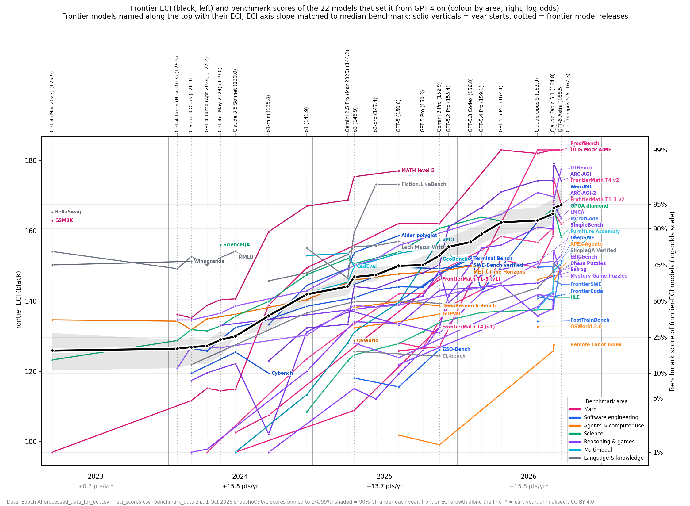
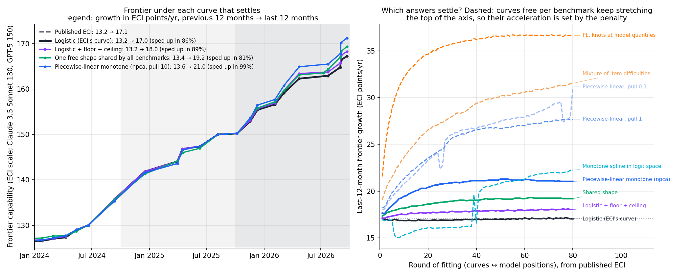
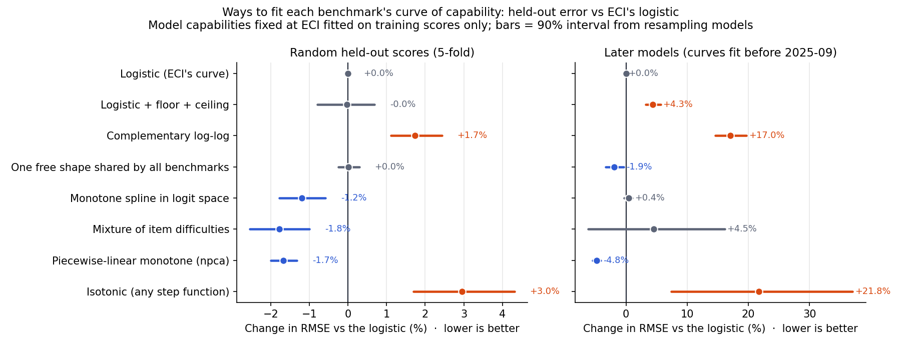
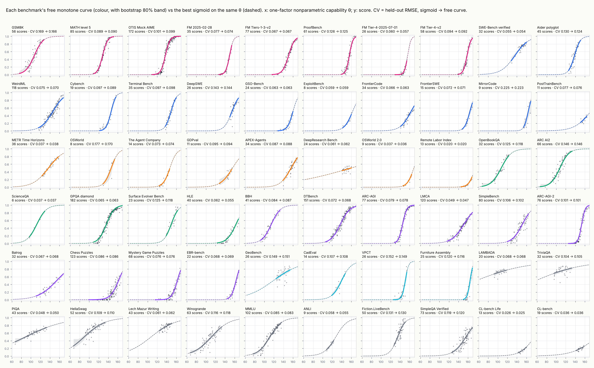

# Frontier ECI and the benchmark scores behind it

> **Working on this repo?** Start with [`NEXT_STEPS.md`](NEXT_STEPS.md): current findings, open questions and a map of the code.

## Key takeaways: is ECI measuring benchmark-score acceleration correctly?

1. **The arithmetic is right.** Our reimplementation of Epoch's objective matches theirs term for term ([`scripts/eci_fit.py`](scripts/eci_fit.py) against eci-public's `fitting.py`). It reproduces published ECI to within 0.06 points, mean 0.006. A tightly converged scipy fit agrees to 1e-4, and the in-browser solver agrees with the Python one to 1e-13. Any problem is in the model's assumptions, not the computation.
2. **ECI's own speed-up depends on where the 12-month windows end.** Published frontier ECI rose 13.2 → 17.1 points a year (previous 12 months → last 12) with windows ending on the 1 Oct 2026 snapshot. End them on 1 Sep instead and it is 15.0 → 14.7; on 1 Aug, 16.8 → 13.6. The last year's rate is set mainly by a cluster of September 2026 records and by frontier models scored on only 4–7 benchmarks. A running maximum of noisy estimates is also biased upward. So "ECI shows acceleration" is not established either way.
3. **The logistic curve systematically mispredicts newer models.** Fit curves on models released before Sep 2025, then predict half of each later model's scores from the other half ([`scripts/npca_forward.py`](scripts/npca_forward.py)). Later models score 13 points *above* the logistic's prediction where it predicts under 20%, and 10 points *below* where it predicts over 80%.
   - Benchmarks saturate more slowly than a logistic assumes, so the last points toward 100% need more capability than ECI credits.
   - ECI's least squares in score units makes these near-ceiling misses cheap: predicting 95% for a 99% score costs 0.04 in score units but 1.6 in log-odds.
   - Across three random splits, the piecewise-linear curves predict later models 3–17% better, improving steadily as the pull toward the logistic weakens. A floor and ceiling help by about 1%. The one shared free shape is no better (+8.5%, 90% interval −1.8% to +21%), so the gain comes from benchmark-specific shapes.
4. **Relaxing the curve always makes recent growth look faster than ECI says.** For every window end from June to October 2026, last-year growth is higher than under the logistic:
   - logistic + floor + ceiling: +0.8 to +1.0 points a year
   - one shared free shape: +1.0 to +2.3
   - the piecewise-linear curve (pull 10): +2.5 to +4.0
   - weaker pulls: +7 to +14

   The ratio of last-year to previous-year growth also barely moves when the upper anchor is changed (1.54 for the piecewise-linear curve against 1.29 for the logistic). The *direction* is robust: ECI's logistic understates recent gains relative to curves that fit the data better.
5. **But the size of the correction is not identified.** Above GPT-5 (fixed at 150), nothing pins the spacing between models except the curve's shape.
   - The curves the forward test favours (weak pulls of 1 and 0.1) never settle in joint fits: last-year growth is still rising at 28–31 points a year after 80 rounds.
   - Random cross-validation is flat across penalty settings and nearly blind to spacing, so the piecewise-linear curve's 21 points a year reflects a chosen pull, not an estimate.
   - The most defensible flexible number is the shared free shape's 19.2 (against 17.0 for the logistic). The honest summary: ECI probably understates how fast frontier capability rose in the last year, by an amount these data can't pin down, and whether growth is *accelerating* at all depends on the measurement window.

Epoch AI's [Capabilities Index](https://epoch.ai/eci) (ECI) fits one capability number per model from ~60 benchmarks, using

    score = sigmoid(slope_b × (ECI_model − difficulty_b))

so on a log-odds scale every benchmark should rise linearly with ECI. These charts plot that directly: the benchmark scores of the models that set the frontier ECI, in log-odds, with frontier ECI overlaid on a second axis.



- **Interactive version:** https://tecunningham.github.io/eci-benchmark-logodds/ (source [`index.html`](index.html)). Choose a lab to see that lab's own frontier (running best ECI among its models), with the overall frontier dashed for comparison. Untick benchmarks to **refit ECI** on the rest (see below). The chart runs full width, and the page has three more controls:
  - **Curve:** shows the frontier under any benchmark curve whose joint fit settles: Epoch's logistic, logistic plus floor and ceiling, a shared free shape, or the piecewise-linear curve. The method is in the nonparametric section below.
  - **Scale:** *Scores in log-odds* is the original view. *Capability each score implies* maps every score back through its benchmark's own fitted curve onto the frontier's axis. For the logistic, that is each benchmark's log-odds rescaled by its own slope and difficulty. Before mapping, each score is pinned to 1%–99% of the way from its curve's floor to its ceiling, as the log-odds view pins scores to 1%–99%. Pinned scores are drawn hollow. Without the pin, a score at or past a fitted floor or ceiling, which the curve can't invert, would land at the end of the range; this mattered most for logistic + floor + ceiling.
  - **From:** zooms in by moving the earliest date shown.
  - **Hover** a score to see the capability it implies and its **weight in that model's capability**. Least squares places a model where its misses balance; linearised, that makes its capability a weighted average of the capabilities its scores imply. Each score's weight is its curve's slope at the model's capability, squared, and the hover shows its share of the model's total. Scores where the curve is flat, near 0% or 100%, barely count. Claude Opus 5.5's 87.5% on GPQA diamond implies 151.6 but carries under 0.1% of its ECI, because the logistic has already saturated at 167. These weights rebuild every model's capability from its implied values to within 0.12 points (median).

  The two fixed points of the scale, Claude 3.5 Sonnet ≡ 130 and GPT-5 ≡ 150, are marked under every curve. The link records every setting, e.g. `#lab=OpenAI&curve=monotone&scale=implied&from=2025-01-01`.
- **Right axis:** each benchmark's score for the models that set a new frontier ECI, as log-odds, labelled in percent. Colour is the benchmark's area.
- **Left axis:** frontier ECI (running maximum by release date), drawn as straight lines between successive records, with its 90% interval. The axis is scaled so a benchmark with the median fitted slope (0.107 logits per ECI point) runs parallel to the ECI line.
- **Top:** the 22 record-setting models from GPT-4 (Mar 2023) on, with their ECI.
- **Under each year:** how many ECI points the frontier line rose between 1 January and 31 December. Starred years are only partly covered (from the first record, or up to the latest one) and are annualised.

## Nonparametric version: is progress accelerating, and how does that depend on the curve?

**Interactive:** https://tecunningham.github.io/eci-benchmark-logodds/npca.html (source [`npca.html`](npca.html)).

### Is progress accelerating? It depends on the curve



[`scripts/npca_accel.py`](scripts/npca_accel.py) fits each curve option *jointly* with capability. It alternates between fitting the curves and placing the models, 80 rounds from published ECI, with Claude 3.5 Sonnet = 130 and GPT-5 = 150 fixing the scale. It then measures the frontier's growth in the last 12 months (2025-10-01 to 2026-10-01) against the 12 months before. Growth is in ECI points per year.

| Curve | Previous 12 months | Last 12 months | 90% interval, last 12 months | Share of resamples that sped up |
|---|---|---|---|---|
| Published ECI | 13.2 | 17.1 | | |
| Logistic (ECI's curve) | 13.2 | 17.0 | 12.9–22.3 | 86% |
| Logistic + floor + ceiling | 13.2 | 18.0 | 12.5–24.1 | 89% |
| One free shape shared by all benchmarks | 13.4 | 19.2 | 12.8–23.5 | 81% |
| Piecewise-linear monotone (npca, pull 10) | 13.6 | 21.0 | 16.8–27.6 | 99% |
| Monotone spline in logit space | 15.0 | 22.2 | still rising | — |
| Piecewise-linear, pull 1 | 14.2 | 27.7 | still rising | — |
| Piecewise-linear, pull 0.1 | 14.2 | 31.1 | still rising | — |
| Piecewise-linear, knots at model quantiles (pull 10) | 13.8 | 36.7 | still rising | — |
| Mixture of item difficulties | 14.5 | 31.5 | still rising | — |

Intervals come from 100 refits on benchmarks resampled with replacement. They're only computed for curves whose answer settles.

- **The earlier rate is agreed: 13.2–13.6 points a year under every curve that settles.** ECI's logistic says growth rose to 17 points a year, a speed-up in 86% of resamples.
- **Curves that predict newer models better read more acceleration:**
  - The shared free shape gives 19.2.
  - The piecewise-linear npca curve gives 21.0, about 1.5 times the earlier rate, with a speed-up in 99% of resamples. It is the curve that is clearly better on later models in the comparison below.
- **The direction is robust; the size isn't.** A curve that is free per benchmark doesn't pin down the spacing between models. With a weaker pull toward the logistic, quantile-placed knots, or an item mixture, the fit keeps stretching the top of the axis, and the last-year rate climbs to 22–37 points a year without settling (dashed lines in the figure). Only curves tied to a common shape give a number set by the data. Of those, the shared shape is the most flexible, and it gives 19.2.
- **Mechanism.** Logistic curves fitted on older models rise too steeply. Later models score above the prediction where predicted scores are low, and below it near the top. In the 80–100% band, the error is -0.062 for the logistic and -0.038 for the piecewise-linear curve. So benchmarks saturate more slowly than the logistic assumes, and the last points toward 100% take more capability than ECI credits. The models that won those points, last year's frontier, therefore sit higher. The piecewise-linear curve corrects part of this, which is why it both predicts later models better and reads more acceleration.

**Which benchmarks drive it?** [`scripts/curve_fits.py`](scripts/curve_fits.py) refits both curves with each benchmark left out in turn. The extra last-year growth of the piecewise-linear curve over the logistic (4.0 points a year) survives every single drop (3.6–5.9), so no one benchmark carries it.
- **Largest contributors:** HellaSwag (+0.45), ProofBench (+0.41), SimpleBench (+0.35), PIQA (+0.34), GPQA diamond (+0.31).
- **Pulling the other way:** FrontierMath T1–3 v2 and OTIS Mock AIME.
- **Where each benchmark's own free curve places last year's models highest relative to the logistic:** the largest shifts are VPCT (+5.6 ECI points, only 5 recent scores), Mystery Game Puzzles (+3.4), EBR-bench (+2.3) and FrontierMath T4 v2 (+2.2), all low-scoring benchmarks. Among heavily scored, near-saturated ones, they are OTIS Mock AIME (+2.2), GPQA diamond (+2.0) and ARC-AGI (+1.3). The shift is measured on the piecewise-linear fit's own, stretched axis, so it mixes each benchmark's curve shape with the overall stretch and is biased upward. GPQA diamond is the only benchmark with a sizeable push toward more acceleration on both measures.

### Forward test of the joint fits: which curve predicts models above the top anchor?

[`scripts/npca_forward.py`](scripts/npca_forward.py) is the one held-out test that touches the spacing above GPT-5:
1. Run the joint fit (curves and positions, 80 rounds) on models released before 2025-09-01 only (1569 scores), starting from ECI refit on those scores. Both anchors are in this set.
2. Place each of the 93 later models from a random half of its scores, with the curves frozen. The frozen piecewise-linear curves are refit on knots reaching 80 points above the top training model, so they can extrapolate rather than go flat.
3. Predict the other half (473 scores, on benchmarks with at least 5 training scores).

| Curve | RMSE | vs logistic (90% interval) | Later minus predicted, where predicted < 20% | where predicted > 80% | Last-12-month growth, full joint fit |
|---|---|---|---|---|---|
| Logistic (ECI's curve) | 0.1748 | +0.0% (+0.0 to +0.0) | +0.131 | -0.100 | 17.03 |
| Logistic + floor + ceiling | 0.1738 | -0.6% (-1.6 to +0.2) | +0.128 | -0.080 | 18.03 |
| One free shape shared by all benchmarks | 0.1897 | +8.5% (-1.8 to +21.3) | +0.165 | -0.027 | 19.19 |
| Piecewise-linear, pull 30 | 0.1701 | -2.7% (-4.6 to -0.6) | +0.126 | -0.078 |  |
| Piecewise-linear, pull 10 (default) | 0.1662 | -4.9% (-8.0 to -2.3) | +0.111 | -0.070 | 21.04 |
| Piecewise-linear, pull 3 | 0.1632 | -6.7% (-8.9 to -3.9) | +0.104 | -0.057 |  |
| Piecewise-linear, pull 1 | 0.1588 | -9.2% (-11.8 to -6.4) | +0.087 | -0.050 | 27.69 |
| Piecewise-linear, pull 0.1 | 0.1578 | -9.8% (-15.2 to -4.2) | +0.100 | -0.080 | 31.15 |

- **Two other random splits** give the same ordering (logistic → pull 0.1): −0.7/−1.5% for floor + ceiling, −3.5/−4.2% for pull 10, −11.3/−14.6% for pull 1, −13.4/−17.4% for pull 0.1.
- **The forward test favours the weakest pulls**, and those are exactly the curves whose joint fits never settle. It therefore says the logistic's spacing above 150 is too compressed, without pinning the right spacing.
- **Not a measure of growth:** frontier growth computed from the forward-placed later models comes out at 60–80 points a year for every curve, because placing a model from half its scores, past the training range, is too noisy. It is stored in the json but shouldn't be read as a growth estimate.

Rebuild: `python npca_forward.py` (about 6 minutes on 3 cores) → `data/npca_forward.json`.

Rebuild (about 20 minutes on 8 cores; `curve_fits.py` another 6):

```bash
cd scripts
python npca_accel.py          # joint fits, iteration paths, bootstrap -> data/npca_accel.json
python npca_accel_figure.py   # -> figures/npca_accel.png
python curve_fits.py          # dashboard curves + leave-one-out -> data/curve_fits.json, data/curve_leverage.json
python npca_build_page.py     # -> ../npca.html
python build_page.py          # -> ../index.html
```

### Seven ways to fit a benchmark's curve

ECI assumes every benchmark's score follows a logistic curve of capability. [`scripts/npca_links.py`](scripts/npca_links.py) fits seven different curves to each benchmark and compares them on scores they never saw. Each model's capability is held fixed at ECI refit on the training scores only, so only the curve differs.



| Curve | Parameters per benchmark | Keeps spacing between models? | Random held-out RMSE (vs logistic) | Later-models RMSE (vs logistic) |
|---|---|---|---|---|
| Logistic (ECI's curve) | 2 | yes | 0.0947 (0.0%) | 0.1656 (0.0%) |
| Logistic + floor + ceiling | 4 | yes | 0.0943 (−0.4%) | 0.1655 (−0.1%) |
| One free shape shared by all benchmarks | 2 (+ 1 shared curve) | yes | 0.0947 (+0.0%) | 0.1624 (−1.9%) |
| Monotone spline in logit space | 8, penalised | only through the penalty | 0.0936 (−1.2%) | 0.1663 (+0.4%) |
| Mixture of item difficulties | 30 weights, penalised | no (keeps stretching in joint fits) | 0.0930 (−1.8%) | 0.1731 (+4.5%) |
| Piecewise-linear monotone (npca) | 28, penalised | only through the pull to the logistic | 0.0931 (−1.7%) | 0.1577 (−4.8%) |
| Isotonic (any step function) | up to n | no | 0.0975 (+3.0%) | 0.2016 (+21.8%) |

How each curve works:
- **Floor and ceiling** let a benchmark start above 0% or top out below 100%. They are attainable bounds, so the floor can't sit above any observed score and the ceiling can't sit below one, and both are pulled toward 0 and 1 (weight 1, chosen on the random folds). Fitted freely, least squares puts the "ceiling" at the *average* score of the strongest models, below many of their scores: 96% on OTIS Mock AIME, with 26 of 172 scores above it. It then extrapolates badly (+4.3% on later models). With the constraint, ceilings well below 100% remain only where scores plateau: MMLU at 89%, SimpleBench at 87%, GPQA diamond and ARC-AGI-2 near 95%.
- **Shared shape** learns one free S-shape for all benchmarks; each benchmark keeps its own slope and difficulty.
- **Monotone spline in logit space** fits a monotone spline to the log-odds of the score, penalised for bending. A very large penalty gives back the logistic exactly.
- **Item-difficulty mixture** treats a benchmark as many questions of different difficulty, each answered on a logistic with one slope shared by all benchmarks. The curve is a non-negative weighted average of those logistics.
- **Piecewise-linear monotone** is the curve in `npca_fit.py`, pulled toward the logistic.
- **Isotonic** is any rising step function, with no smoothing.

The two held-out tests:
- **Random:** 5-fold over all 2,844 scores.
- **Later models:** curves are fit on models released before 2025-09, then used to predict half of each later model's scores (473 scores).

The spline's penalty and the mixture's settings were tuned on the random folds, so their random numbers are slightly flattering. The later-models test wasn't used for tuning.

What the comparison shows:
- **No shape beats the logistic by much.** On random held-out scores, the best curves (the item mixture and the piecewise-linear curve) cut error by under 2%. The gains come from heavily scored benchmarks such as OTIS Mock AIME, WeirdML, GSM8K, DTBench and MMLU.
- **Extrapolation separates them.** On later models, the piecewise-linear curve does best (−4.8%), because it falls back to the logistic beyond its data. The item mixture is erratic there, since it has no item difficulties beyond its training range. Isotonic extrapolates badly (+21.8%). A fitted floor and ceiling neither help nor hurt (−0.1%).
- **The S-shape itself is right.** The shared shape ends up within 0.034 of the logistic everywhere. Departures from the logistic are specific to individual benchmarks, not a general problem with the shape.
- **The real trade-off is spacing.** A curve that is free for each benchmark can absorb any stretch of the capability axis. Only the *order* of models is then identified, and the speed of progress comes from the pull toward the logistic. A shared shape keeps the spacing identified. A mixture with one item slope doesn't: in the joint fits above it keeps stretching too. Since accuracy differs so little, that is the main reason to pick one over another.

Rebuild this comparison (about 20 seconds; needs `scipy` and `scikit-learn`):

```bash
cd scripts
python npca_links.py          # -> data/npca_links.json
python npca_links_figure.py   # -> figures/npca_links.png
python npca_build_page.py     # -> ../npca.html
```

### Joint fits: free curves and a second factor



Here capability is re-estimated together with the curves. In the later-models test, later models are placed using only these frozen curves rather than a joint ECI refit, so these errors are higher than in the table above and can't be compared with it directly.

ECI is a rank-1 logistic PCA of the model × benchmark matrix. [`scripts/npca_fit.py`](scripts/npca_fit.py) relaxes it in two ways:

    score_mb = g_b(u_m · dir_b),   g_b nondecreasing,   dir_b = (cos α_b, sin α_b)

- **Monotone link.** Each benchmark's curve `g_b` can take any monotone shape. It is piecewise linear with nonnegative rises, fit by NNLS, penalised for curvature and shrunk towards that benchmark's own sigmoid. The penalties (smoothness 30, pull 10) sit near the minimum of a flat 5-fold CV surface ([`scripts/npca_tune.py`](scripts/npca_tune.py)). Treat them as a choice, not an estimate.
- **Two factors.** Each model is a point in the plane and each benchmark a direction.

All four combinations of sigmoid or monotone curve, with one or two factors, are fit with ECI's squared-error objective and compared on held-out scores:
- **Random:** 5-fold over cells.
- **Forward:** curves are fit on models released before Sep 2025; each later model is placed from half of its scores and the other half are predicted. Caveat: in this script the frozen curves are flat beyond the training range, so no later model can be placed above about 152. This column therefore says nothing about spacing above GPT-5. [`scripts/npca_forward.py`](scripts/npca_forward.py) (below) is the corrected test.

Results (RMSE in score units):

| Fit | In-sample | Random CV | Forward CV |
|---|---|---|---|
| ECI (Epoch's code) | — | 0.0945 | — |
| 1 factor, sigmoid | 0.0748 | 0.0942 | 0.1793 |
| 1 factor, monotone | 0.0720 | 0.0929 | 0.1776 |
| 2 factors, sigmoid | 0.0612 | 0.0952 | 0.1799 |
| 2 factors, monotone | 0.0588 | 0.0936 | 0.1797 |

- **Free curves help a little.** They cut held-out error by about 1.4%. The best curves stay close to the sigmoid, so the sigmoid is a good approximation.
- **A second factor cuts in-sample error a lot, but not held-out error.** With a median of 9 scores per model, the data don't support a second dimension.
- **Only the ordering of models is identified.** With a free monotone curve, the spacing between models (and so the *speed* of progress) comes from the sigmoid assumption. The page's last chart shows how much the measured frontier would change if each benchmark's own curve set the scale.

Rebuild the joint fits (about 15 minutes on 4 cores; also needs `scipy`):

```bash
cd scripts
python npca_build.py        # fits, CV, bootstrap -> data/npca.json
python npca_tune.py         # optional: reproduce the CV behind npca_fit.py's penalties and priors (prints only, ~35 min)
python npca_figure.py       # -> figures/npca_curves.png
python npca_build_page.py   # npca_page_template.html + npca.json -> ../npca.html
```

## Data

`data/epoch/` holds three files from Epoch's [`benchmark_data.zip`](https://epoch.ai/data/benchmark_data.zip), snapshot of 1 Oct 2026:

| File | What it is |
|---|---|
| `processed_data_for_eci.csv` | The exact table the ECI is fit on: one row per model group × benchmark |
| `eci_scores.csv` | Published ECI per model, with 90% intervals |
| `edi_scores.csv` | Fitted benchmark difficulty and slope |

Scores are already floor- and ceiling-adjusted. Each is `(raw − random-guess baseline) / (attainable ceiling − baseline)`, clipped to [0, 1], taking the best version within each model group. This was checked: all 2,844 rows reproduce exactly from the raw score files and `benchmark_metadata.csv` in the zip.

## Choices

- **Start date.** Models released before GPT-4 (14 Mar 2023) are left out of the chart. They still affect the ECI values, since Epoch fits all models jointly.
- **Frontier.** Running maximum of ECI by release date. When several models share a date, only the highest counts.
- **Labs.** A model's lab is the first organisation Epoch lists for it ("Google" merged into "Google DeepMind", "Microsoft Research" into "Microsoft"; the 17 models with no organisation are assigned by model family where obvious, else "Other"). Labs with at least five models since GPT-4 appear in the interactive page's lab menu. ECIs come from Epoch's joint fit over all labs, so a lab's frontier is comparable with the overall one.
- **Zeros and ones.** Scores of exactly 0 or 1 are pinned to 1% and 99% so their log-odds are finite.
- **Areas.** The primary (first) domain tag on [epoch.ai/eci](https://epoch.ai/eci), grouped into seven areas (see `scripts/areas.py`). Seven benchmarks have no tag there and were assigned by hand: METR Time Horizons and DeepResearch Bench (agents), LMCA (reasoning), Lech Mazur Writing (language), GeoBench (multimodal), and the two FrontierMath v1 sets (math).

## Refitting ECI in the browser

The page can re-estimate ECI on any subset of the 60 benchmarks. It uses Epoch's model and objective from [eci-public](https://github.com/epoch-research/eci-public) (`src/eci/fitting.py`):

    score = sigmoid(slope_b × (capability_m − difficulty_b)),  scores clipped to [0.001, 0.999]
    minimise  Σ (predicted − score)²  +  0.1 × |params|² / n_params

Winogrande's slope is pinned at 1 to fix the raw scale, and the result is mapped linearly so that Claude 3.5 Sonnet = 130 and GPT-5 = 150. Epoch solves this with scipy's `least_squares`. Here it is solved with Levenberg–Marquardt: [`scripts/eci_fit.py`](scripts/eci_fit.py) in numpy and [`scripts/eci_fit.js`](scripts/eci_fit.js) in the browser. The two agree to within 0.0001 ECI. Each refit takes 10–50 ms.

- **With every benchmark ticked**, the page shows Epoch's published ECI and 90% intervals. Our own full fit reproduces the published values to within 0.06 points. scipy stops at its default tolerance, while this solver goes on to a slightly lower objective, and the leftover differences are in models with few scores.
- **Without Winogrande**, the benchmark with the most scores is pinned instead, at its slope from the full fit.
- **Dropped models.** A model with no scores left drops out. The two anchor models must keep at least one score.
- **On the chart.** Unticked benchmarks stay visible as faded dotted lines, and the published frontier is drawn faded behind the refitted one.
- **No intervals for refits.** Epoch's intervals come from 500 bootstrap refits, which the page doesn't run.
- **Median slope.** The slope-matched axis uses the median slope of the refit.

## Rebuild

```bash
pip install pandas numpy matplotlib
cd scripts
python build_data.py     # data/epoch/*.csv -> data/frontier_all.json, data/eci_data.json
python make_figure.py    # -> figures/eci_frontier_all.png
python build_page.py     # page_template.html + eci_data.json + curve_fits.json + eci_fit.js -> ../index.html (run curve_fits.py first)
```

The interactive page embeds `eci_data.json` and the solver. That data holds every model and score in Epoch's fit, tagged by lab, plus the raw parameters of our full fit, which each refit starts from. The page computes each lab's frontier in the browser. It uses Plotly from jsDelivr and falls back to the static PNG if that fails to load.

## Credit

Data: Epoch AI, [Epoch Capabilities Index](https://epoch.ai/eci), CC BY 4.0. Method: [A Rosetta Stone for AI Benchmarks](https://arxiv.org/abs/2512.00193) and [eci-public](https://github.com/epoch-research/eci-public).
